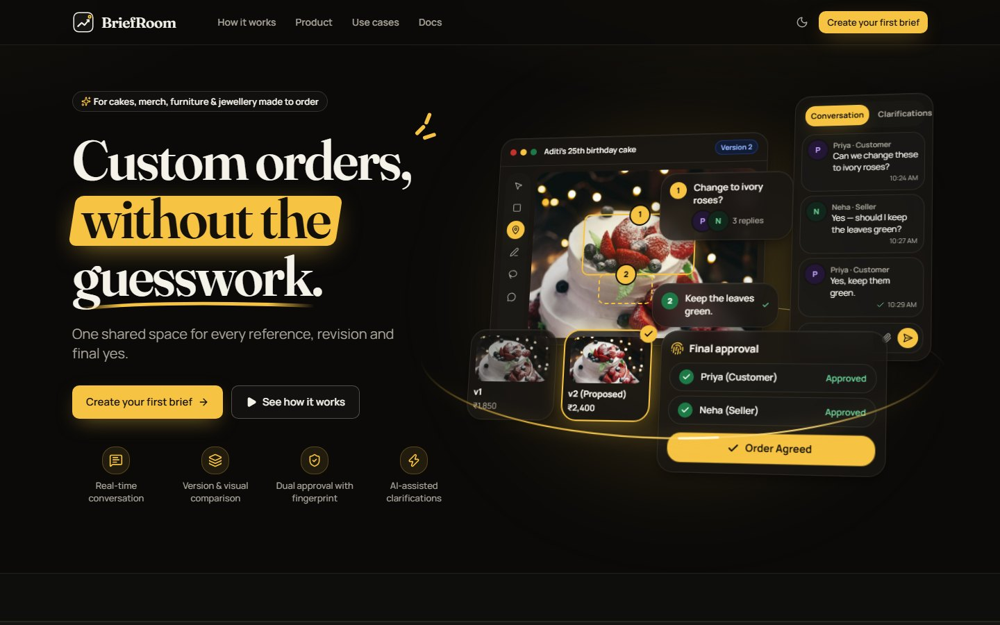
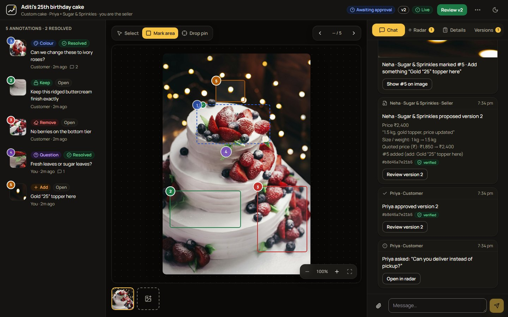
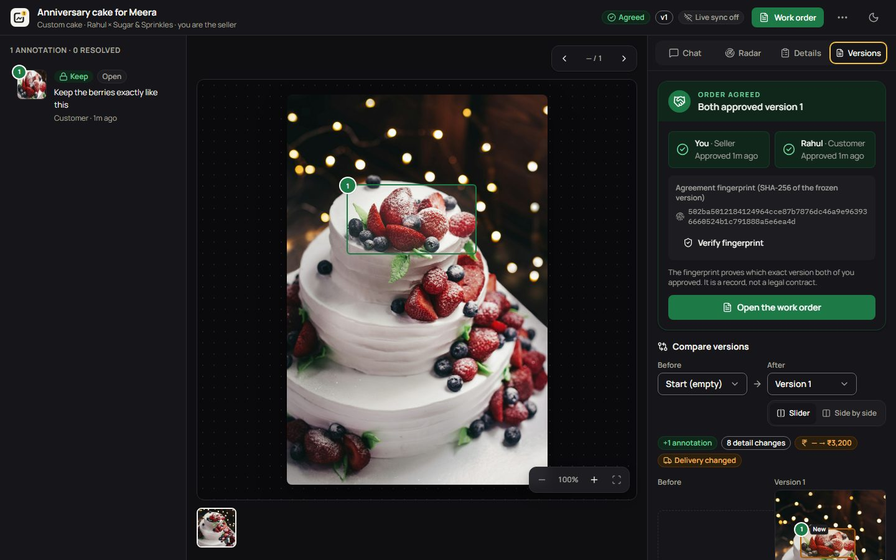
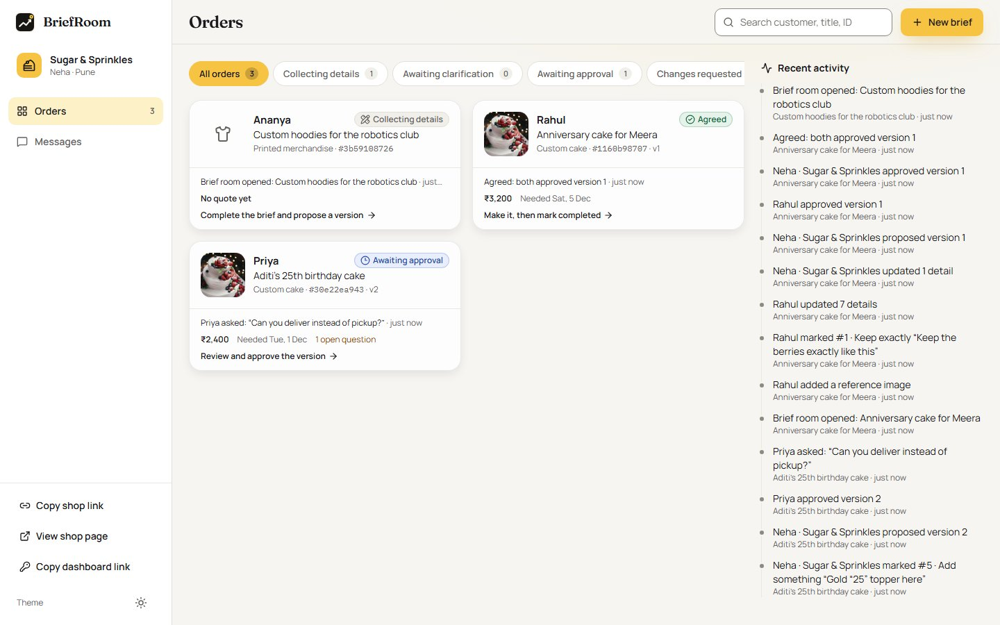
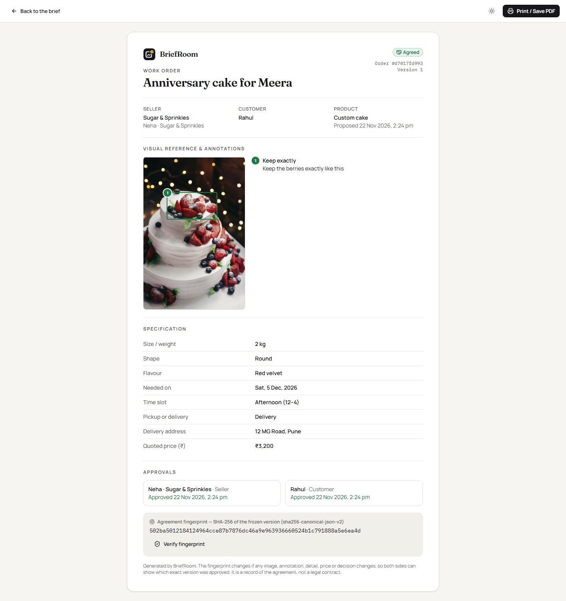

<div align="center">

<picture>
  <source media="(prefers-color-scheme: dark)" srcset="docs/brand/briefroom-logo-dark.svg" />
  
</picture>

**Custom orders, without the guesswork.**

One shared space for every reference, revision and final yes, with real-time conversations built on [Nexconn](https://docs.nexconn.ai).

[What it does](#what-it-does) · [How it works](#how-it-works) · [Built on Nexconn](#built-on-nexconn) · [Architecture](#architecture) · [Run it locally](#run-it-locally) · [Deploy](#deploy) · [Docs](#documentation)

<sub>Nexconn Build Challenge 2026 · Marketplace & Support · Web</sub>

</div>



## The problem

Custom orders — a birthday cake, printed merchandise, a made-to-measure table, a ring — start with “something like this” and a photo. Then come screenshots, voice notes and “the flowers on the left” spread over sixty chat messages. Nobody can point to exactly what was agreed, so mistakes turn into remakes, refunds and arguments.

## What it does

BriefRoom gives every order one private room, shared by the seller and the customer. The customer needs no app or account, just a link. In that room:

| | |
|---|---|
| 📍 **Point at the exact region** | Draw a region or drop a pin on any reference photo and say what you mean: keep, change, recolour, remove, add or ask. Coordinates are stored relative to the image, so markers stay in place on every screen size. |
| 💬 **Talk where the problem is** | Each region has its own thread. The order's conversation runs on Nexconn in real time, with text, photos and live update cards for every change. |
| 🧭 **See what is still undecided** | The **Clarification Radar** collects missing required details, open questions and critical issues. Critical items block the next version until someone records the answer. An ambiguity check (deterministic rules, plus OpenAI or Grok when configured) suggests questions and quotes the exact words that triggered them. |
| 🧾 **Know what changed** | The seller freezes the brief into versions. A visual comparison shows what changed between them: specification, annotations, price and delivery. |
| 🤝 **Agree on one version** | The order becomes **agreed** only when both people approve the same version and the same SHA-256 fingerprint. That approval is checked atomically on the server. A printable A4 work order records the result, and the fingerprint can be verified in the browser. |

Plus:
- a seller dashboard with an order pipeline and a Nexconn Chat UI inbox
- a public shop page
- structured templates for cakes, merchandise, furniture and jewellery
- Light, Dark and System themes
- layouts that work on phones down to 360 px

<table>
  <tr>
    <td width="50%"><br /><sub>The workspace with its live Nexconn conversation</sub></td>
    <td width="50%"><br /><sub>Agreed: both approved the same version and fingerprint</sub></td>
  </tr>
  <tr>
    <td width="50%"><br /><sub>Seller dashboard (light theme)</sub></td>
    <td width="50%"><br /><sub>Printable work order with a verifiable fingerprint</sub></td>
  </tr>
</table>

## How it works

1. **Share a reference.** The seller opens a brief room and sends the customer a private link. The customer uploads “something like this”.
2. **Point at what you mean.** Both people mark regions on the photo and discuss each one in place.
3. **Settle open questions.** The Clarification Radar and the structured specification turn vague requests into decisions.
4. **Both approve one version.** The seller proposes a frozen version. When both people approve that same fingerprint, the order is agreed and the work order is ready.

The seller and customer stay in sync throughout. Every change in the brief is published to the order's Nexconn group as a custom message, so the other person's screen updates without a refresh.

## Built on Nexconn

| Nexconn product | How BriefRoom uses it |
|---|---|
| **Chat SDK** (`@nexconn/chat`) | The workspace conversation is BriefRoom's own themed UI. It connects with **server-issued tokens** to one **private group channel per order** (seller and customer only), and supports real-time text, image messages, server history and automatic reconnection. It also renders **custom `BR:*` messages** as activity cards that refresh the brief live. |
| **Chat UI** (`@nexconn/chatui`) | The seller's inbox across all orders, with ServiceHooks scoped to the seller's own shop and a custom component for the `BR:*` cards. |
| **Platform Chat API** (server) | Token issuance, idempotent group creation and message sending. Requests are signed on the server, so the App Secret never reaches a browser. A transactional outbox delivers every domain event exactly once per order, in order, with retries. |

The integration was verified live against a real Nexconn app, with two independent users. The checks covered real-time messages both ways, image messages, custom events (in order, exactly once), idempotent retries, history after reload, reconnection after a network drop and the Chat UI inbox. The same messages were confirmed in the Nexconn Console's message tracking. Details: [docs/RELEASE_VERIFICATION.md](docs/RELEASE_VERIFICATION.md).

<details>
<summary>Domain events → Nexconn custom messages</summary>

| Domain event | Custom message |
|---|---|
| ORDER_CREATED | `BR:OrderCreated` |
| REFERENCE_ADDED | `BR:ReferenceAdded` |
| ANNOTATION_CREATED | `BR:AnnotationCreated` |
| ANNOTATION_COMMENTED | `BR:AnnotationComment` |
| ANNOTATION_UPDATED / _RESOLUTION_REQUESTED / _RESOLVED / _REOPENED / _DELETED | `BR:AnnotationUpdated` |
| CLARIFICATION_RAISED | `BR:ClarificationRaised` |
| CLARIFICATION_RESOLVED | `BR:ClarificationResolved` |
| SPECIFICATION_UPDATED | `BR:SpecUpdated` |
| VERSION_PROPOSED | `BR:VersionProposed` |
| VERSION_APPROVED / VERSION_REJECTED | `BR:VersionDecision` |
| ORDER_AGREED | `BR:OrderAgreed` |
| REFERENCE_REMOVED, CLARIFICATION_COMMENTED/_REOPENED, ORDER_REOPENED/_COMPLETED | `BR:OrderUpdated` |

</details>

## Architecture

```
Browser (React 19 SPA · Tailwind v4 design tokens · Light / Dark / System)
 ├─ Workspace: canvas · annotations · Clarification Radar · specification · versions · approvals
 │    └─ Conversation on the Nexconn Chat SDK (BR:* activity cards)
 ├─ Seller dashboard: pipeline · activity · Nexconn Chat UI inbox
 └─ REST /api/* (capability keys in the x-key header)
                    │
Express API ────────┤ every change = ONE Postgres transaction:
                    │   lock the order → change → recompute status → append domain event (= outbox)
                    ├─ Outbox ──► Nexconn Platform Chat API (group per order, BR:* messages, retries, ordering)
                    ├─ Images ──► Neon Object Storage (private bucket, presigned reads)
                    └─ AI ──► deterministic rules + OpenAI / Grok (optional, evidence-grounded)
Neon Postgres (Drizzle schema + versioned migrations; triggers keep versions and approvals immutable)
```

- **The backend owns the agreement; Nexconn carries the communication.** Chat messages are signals and display hints. Clients re-fetch authoritative state, and “verified” badges on chat cards are checked against the API.
- **Approvals bind to order + version + SHA-256 snapshot hash.** The final approval is serialised by a row lock, and the order becomes agreed in that same transaction.
- **Versions are immutable in the database.** Later changes become a new version that needs both approvals again.
- **No fake chat.** Without Nexconn credentials the app says so (“Live sync off”) instead of simulating anything.

## Tech stack

| Layer | Choice |
|---|---|
| Frontend | React 19, TypeScript, Vite, React Router, Tailwind CSS 4, Radix UI, Motion, React Hook Form + Zod |
| Backend | Node.js 22+, Express 5, Zod |
| Data | Neon Postgres (node-postgres, Drizzle ORM + migrations) · Neon Object Storage (S3 API) |
| Real time | Nexconn Chat SDK, Chat UI and Platform Chat API |
| AI (optional) | OpenAI or Grok (xAI) with JSON-schema output, plus deterministic rules |
| Quality | `node:test` unit + integration tests on real migrations, Playwright end-to-end tests, 80 WCAG contrast checks |

## Run it locally

Requirements: Node.js 22 or newer.

```bash
git clone https://github.com/arjitkulkarni/BriefRoom.git
cd BriefRoom
npm install
npm run dev
```

Open http://localhost:5173 and choose **Create your first brief**. Open the customer link in a private window, or on a phone on the same Wi-Fi.

With no configuration at all, BriefRoom runs on an embedded database and local file storage. It uses rules-only ambiguity checks and shows “Live sync off” for chat. To enable everything, copy [`.env.example`](.env.example) to `.env.local` and add:

- **Neon** Postgres and Object Storage (`neon init` / `neon env pull` write these for you), then run `npm run db:migrate`
- a **Nexconn** App Key and App Secret, plus `NEXCONN_REGION` for your app's data centre
- optionally `OPENAI_API_KEY` and/or `XAI_API_KEY`

Every setting is explained in [docs/CONFIGURATION.md](docs/CONFIGURATION.md).

## Testing

| Command | What it covers |
|---|---|
| `npm test` | Unit and integration tests on real migrations through the HTTP API. They cover approval rules, idempotency, concurrent approvals, database immutability, access control, signed image URLs, and outbox ordering and retries, all against a fake Nexconn API. |
| `npm run test:e2e` | Two browsers, the seller on desktop and the customer on a phone, from an empty shop to an agreed order and work order. Also covers theme persistence and the absence of overflow or console errors from 360 to 1440 px in both themes. |
| `npm run test:live` | Opt-in, real Nexconn: token issuance, idempotent group creation, outbox retry and ordering. |
| `E2E_ENV_FILE=.env.local npm run test:e2e` | The end-to-end suite plus nine live Nexconn checks, against the services configured in that file. |
| `npm run check:contrast` | 80 WCAG contrast checks across both themes. |

## Deploy

[`render.yaml`](render.yaml) is a Render Blueprint for a single stateless web service. All state lives in Neon, so no persistent disk is needed.

- **Build:** `npm ci --include=dev && npm run build`
- **Before each release:** `npm run db:migrate`
- **Start:** `npm start`
- **Health check:** `/api/health`. Add `?deep=1` to also check the database, storage, Nexconn and the AI providers.

Any Node.js host works with the same commands and [environment variables](docs/CONFIGURATION.md).

## Documentation

- [Configuration](docs/CONFIGURATION.md): environment, database, storage, Nexconn and AI
- [Design system](design.md) and its [research](docs/DESIGN_RESEARCH.md)
- [Motion design](docs/MOTION_DESIGN.md), [motion concepts](docs/MOTION_CONCEPTS.md) and [research](docs/MOTION_RESEARCH.md) · before/after: [docs/motion-previews/](docs/motion-previews/)
- [Implementation audit](docs/IMPLEMENTATION_AUDIT.md) and [release verification](docs/RELEASE_VERIFICATION.md)
- [Screenshots](docs/screenshots/)

## Limitations

- **No accounts.** Access is by private links (the seller's dashboard link and the customer's order link).
- **Chat UI has no theming API,** so the seller inbox stays light in dark mode. The workspace conversation is BriefRoom's own themed UI.
- **The ambiguity check is advisory.** The rules use English keyword patterns. AI suggestions are kept only when they quote the brief or chat verbatim.
- **Browser console noise.** The Nexconn Web SDK uploads its own diagnostics to a log collector that currently rejects the SDK's request (CORS), so browsers show a console error. Chat is unaffected.
- **The fingerprint is not a legal contract.** It proves *which* version both people approved; it is not an e-signature.

## Credits and license

Product photos are from [Unsplash](https://unsplash.com) (see [public/images/CREDITS.md](public/images/CREDITS.md)). Real-time messaging is by [Nexconn](https://docs.nexconn.ai); database and storage are by [Neon](https://neon.com).

Released under the MIT License.
