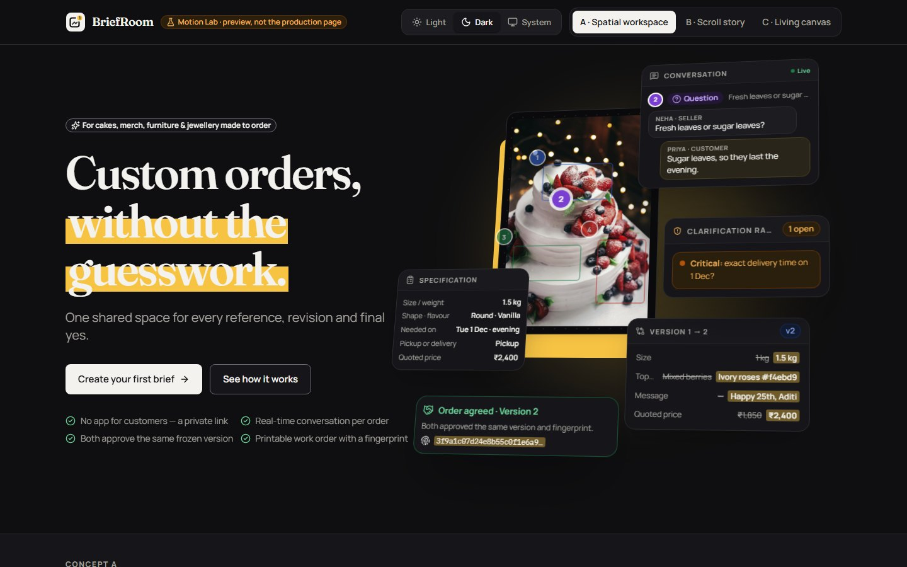
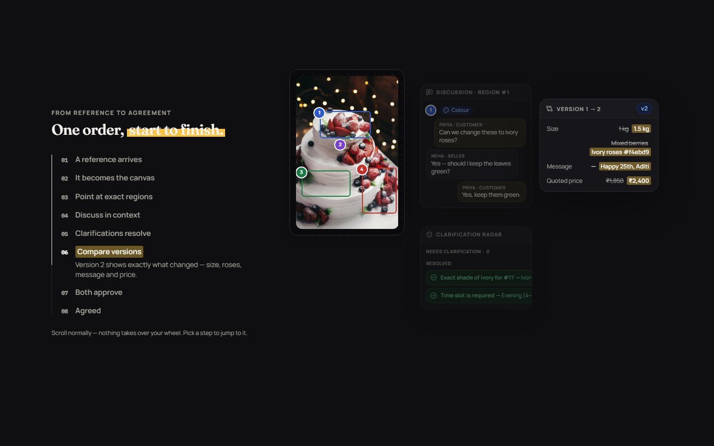
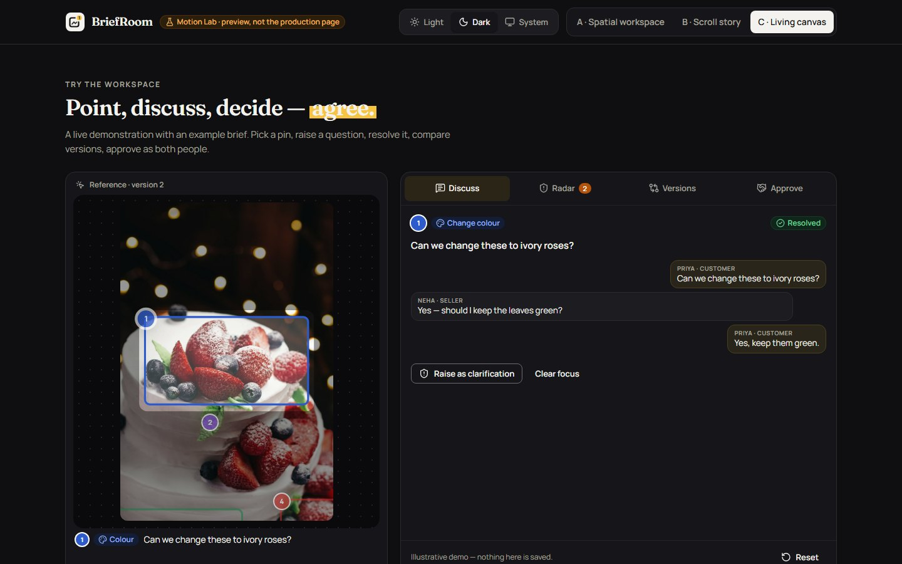

# Motion concepts: comparison

*2026-11-22. Three working prototypes at **`/motion-lab`**: `?c=a`, `?c=b` and `?c=c`. They are isolated from production; no product screen was changed. Motion language: [MOTION_DESIGN.md](MOTION_DESIGN.md) · research: [MOTION_RESEARCH.md](MOTION_RESEARCH.md).*

All three use the landing page's illustrative example brief (Priya × Sugar & Sprinkles), the existing design tokens, and both themes. The stack is Motion with CSS 3D and no new dependencies. Screenshots: `docs/motion-previews/` (desktop 1440 px and phone 390 px, Light and Dark).

## A · Spatial workspace (hero)

**Animation sequence:**
1. The badge appears, then the headline word by word, then the highlighter wipes across "without the guesswork."
2. The supporting line, CTAs and checklist settle with a stagger.
3. The product assembles in depth: yellow plate → canvas → conversation → radar → specification → version → agreement, each flying forward to its own depth.
4. Pins pop up above the photo at four depths, each casting a soft shadow onto the photo.
5. Every 4.2 s, focus moves to the next annotation and the conversation swaps to that region's thread.
6. Once, the two approvals converge into the agreement.
7. With a mouse, the whole composition leans toward the pointer.

| | |
|---|---|
| Strengths | It looks like the product itself is coming alive, so it is immediately understandable, and it looks finished even when the mouse is still. It keeps the brand: dark or paper, serif, yellow plate, highlighter. All text is real DOM: crisp, accessible, translatable. Light, with no WebGL. |
| Weaknesses | Dense on phones. The phone layout drops two panels, and the composition sits below the copy. The hover lift is only discoverable with a mouse. |
| Performance | About 7 composited layers, plus one transform per frame on the leaning container while the mouse moves. Loops pause off-screen. 3.4 KB gzipped. No GPU context. |
| Fit | **The landing hero.** |

## B · Scroll story

**Animation sequence:** a sticky stage with eight steps, driven by native scrolling.
1. The upload card appears.
2. The thumbnail morphs into the canvas.
3. Pins appear.
4. The region #1 discussion arrives under a spotlight.
5. The radar resolves.
6. The version card comes forward while earlier cards recede, and the diff values are highlighted in sequence.
7. Both approvals check in.
8. They converge into the agreement under a soft glow.

The rail shows progress, and a step can be clicked to jump to it.

| | |
|---|---|
| Strengths | The clearest explanation of the whole workflow. It never hijacks the wheel, and scrolling back reverses each state. It is a good storytelling section for judges and first-time visitors. |
| Weaknesses | It is about 6 screens tall, which is long on phones. The phone version shows a caption bar and at most two cards. The meaning depends on scrolling through it, and a skim misses steps. |
| Performance | Scroll progress updates React only when the step changes (8 states). Element motion is on independent timelines, so fast scrolling never leaves half frames. 3.9 KB gzipped. |
| Fit | A **"How it works"** section on the landing page, possibly shortened to 5 steps. |

## C · Living canvas (interactive)

**Animation sequence:**
1. Hover a pin to preview it.
2. Click it to zoom into its region, with a spotlight and counter-scaled pins; the thread emerges.
3. **Raise as clarification** puts it in the radar: the badge rolls and bumps.
4. **Resolve** glides an item into Resolved.
5. The version switch changes the pins on the photo and highlights each changed value.
6. Approve stays locked while anything blocks. Each person's approval animates from their side, both converge into the agreement, and the work-order card unfolds.

| | |
|---|---|
| Strengths | It demonstrates BriefRoom's actual rules, including that approvals are locked until nothing blocks. Fully keyboard and screen-reader operable. These are exactly the micro-interactions the real workspace needs. |
| Weaknesses | It needs interaction to shine and looks calmer than A in a static screenshot. It is a demo, so its data is illustrative and nothing is saved. |
| Performance | No loops at all; motion only on interaction. 5.1 KB gzipped. |
| Fit | **Patterns for the product:** workspace focus, radar, versions and approvals. Optionally also as a "Try it" section on the landing page. |

## Decision (2026-11-22)

The owner approved a **reference design** that extends Concept A: a 3D workspace window with yellow annotations, region callouts, the conversation, v1/v2 cards and a "Final approval" card, circled by a golden orbit. It also brings a slanted highlighter block, a hand-drawn underline, yellow primary actions and a new logo. It shipped as:

- **Landing hero:** `src/features/landing/hero-spatial.tsx`, with Concept A's depth, lean and single ambient loop (light travelling on the orbit) and the approvals converging into **Order Agreed**.
- **The whole app, through the 2.1 visual refresh:** yellow primary, warmer dark palette, glass panels, golden page light, larger radii and the official logo ([design.md](../design.md#21-visual-refresh-2026-11-22)).
- **Concept C's language in the product:**
  - dashboard cards enter with a stagger;
  - chat messages emerge;
  - radar items glide between groups;
  - the active tab is a yellow pill;
  - landing sections reveal on scroll.

Before and after: `docs/motion-previews/before/` and `docs/motion-previews/final/`. The three original concepts stay available at `/motion-lab` as the design record.

## Recommendation (before the decision): A + C (+ a short B)

1. **Landing hero: Concept A.** The spatial composition replaces the static preview, with the existing copy and CTAs and a resting composition that works on touch.
2. **Product screens: Concept C's language,** at UI speed with no 3D:
   - focus spotlight (zoom optional)
   - pins popping in at their real coordinates
   - tabs sliding in the direction of travel
   - radar items gliding to Resolved, with rolling counts
   - diff values highlighted in sequence
   - approvals converging only on the backend's confirmed state

   The same tokens apply to the dashboard (staggered cards), conversation (messages emerging) and work order (paper settle).
3. **Optional landing section: a 5-step Concept B** below the hero, for the "reference → discussion → decision → agreement" story. Skip it if time is short; A + C carry the identity.

**How they combine:** they share one kit (tokens, highlighter wipe, canvas, thread, diff, approval seal), so A's hero, B's story and C's product interactions feel like one system rather than three animations.

## Performance and accessibility summary

| | A | B | C |
|---|---|---|---|
| WebGL | none | none | none |
| Ambient loops | 1 (focus cycle) + 3 slow drifts, paused off-screen | none | none |
| Scroll-linked | no | step selection only | no |
| Reduced motion | resting composition, instant states | instant states, no recede motion | instant states |
| Keyboard | decorative illustration (`role="img"`, labelled) | step buttons on the rail | every control is a button; Esc clears focus |
| Overflow and console errors (1440 / 390, both themes) | none | none | none (a 4 px phone overflow was found and fixed) |
